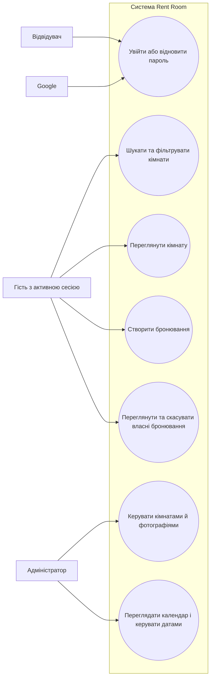

# Вимоги до Rent Room

## 1. Призначення та межі системи

Rent Room — вебзастосунок для пошуку кімнат і керування бронюваннями. Гість може шукати доступні кімнати, переглядати їхні описи та створювати й переглядати власні бронювання. Адміністратор керує кімнатами, фотографіями та доступністю дат.

Документ описує підтверджені сценарії та поточні властивості реалізації. Платежі, сортування кімнат і кількісні гарантії продуктивності до описаних можливостей не належать.

## 2. Актори

- **Відвідувач** — користувач без активної сесії; може перейти до входу або відновлення пароля. Каталог і пошук потребують активної сесії.
- **Гість** — автентифікований користувач із роллю `GUEST`; шукає кімнати, бронює їх і керує власними замовленнями.
- **Адміністратор** — автентифікований користувач із роллю `ADMIN`; керує кімнатами та їхньою доступністю.
- **Google** — зовнішній провайдер автентифікації, доступний під час входу через Google.

## 3. Функціональні вимоги

### FR-01. Автентифікація та відновлення доступу

Система має надавати вхід через email і пароль та Google. Реєстрація через credentials створює обліковий запис, якщо його ще немає. Користувач може запросити скидання пароля та встановити новий пароль за чинним токеном.

**Джерела:** [auth.ts](../src/auth/auth.ts), [auth.actions.ts](../src/auth/actions/auth.actions.ts), `app/auth/login/`, `app/auth/forgot-password/`.

### FR-02. Пошук і фільтрація кімнат

Гість має змогу шукати кімнати за датами заїзду й виїзду та кількістю гостей. Результати не мають включати кімнати, зайняті підтвердженим бронюванням або закриті на вибраний період. Гість може відфільтрувати результати за ціною за ніч.

**Джерела:** [order.actions.ts](../src/lib/actions/order.actions.ts), [SearchWidget.tsx](../src/components/shared/SearchWidget.tsx), [PriceFilter.tsx](../src/components/shared/PriceFilter.tsx), [RoomList.tsx](../src/components/shared/RoomList.tsx).

### FR-03. Перегляд кімнати та бронювання

Гість має змогу переглянути опис, характеристики й фотографії кімнати та створити бронювання на вибрані дати. Створення бронювання потребує активної сесії; сервер відхиляє бронювання, що перетинається з підтвердженим замовленням або закритими датами.

**Джерела:** [page.tsx](../app/guest/room/%5Bid%5D/page.tsx), [BookingPanel.tsx](../src/components/shared/BookingPanel.tsx), [order.actions.ts](../src/lib/actions/order.actions.ts).

### FR-04. Перегляд і скасування власних бронювань

Гість має змогу переглядати свої бронювання, зокрема їхні дати, статус і суму, та скасувати власне замовлення. Система не дозволяє скасувати замовлення іншого користувача.

**Джерела:** [page.tsx](../app/guest/guestProfile/page.tsx), [OrderCard.tsx](../src/components/shared/OrderCard.tsx), [order.actions.ts](../src/lib/actions/order.actions.ts).

### FR-05. Адміністрування кімнат і календаря

Адміністратор має змогу створювати, редагувати й видаляти кімнати, змінювати їхні фотографії та ціну, переглядати календар бронювань і закритих дат, а також блокувати й відкривати дати.

**Джерела:** [room.actions.ts](../src/lib/actions/room.actions.ts), [EditRoomForm.tsx](../src/components/admin/EditRoomForm.tsx), [EditRoomPhotos.tsx](../src/components/admin/EditRoomPhotos.tsx), [DashboardCalendar.tsx](../src/components/admin/DashboardCalendar.tsx), [SetUpDates.tsx](../src/components/admin/SetUpDates.tsx).

## 4. Нефункціональні вимоги: поточний baseline

Наведені нижче пункти фіксують властивості, які можна перевірити в поточному коді. Вони не є гарантіями SLA чи додатковими зобов’язаннями щодо безпеки або продуктивності.

### NFR-01. Представлення сесії та ролей

Поточна реалізація використовує JWT-сесію та додає до неї ідентифікатор користувача й роль `ADMIN` або `GUEST`.

**Джерело:** [auth.config.ts](../src/auth/auth.config.ts).

### NFR-02. Обмеження доступу на рівні маршрутів

У конфігурації маршрутизації активна сесія потрібна для маршрутів, крім явно визначених маршрутів автентифікації; маршрути `/admin` додатково обмежені роллю `ADMIN`. Це описує перевірки маршрутизації й не підтверджує повний захист кожної server action.

**Джерела:** [auth.config.ts](../src/auth/auth.config.ts), [proxy.ts](../proxy.ts).

### NFR-03. Поточне сховище даних

Поточна реалізація використовує MongoDB для даних користувачів, кімнат, замовлень і закритих дат.

**Джерела:** [mongodb.ts](../src/lib/mongodb.ts), [order.actions.ts](../src/lib/actions/order.actions.ts), [room.actions.ts](../src/lib/actions/room.actions.ts).

### NFR-04. Перевірки цілісності дат бронювання

Під час пошуку сервер відхиляє дату заїзду в минулому та дату виїзду, що не є пізнішою за дату заїзду. Під час створення бронювання сервер перевіряє перетин із підтвердженими бронюваннями й закритими датами.

**Джерело:** [order.actions.ts](../src/lib/actions/order.actions.ts).

### NFR-05. Адаптивна верстка як поточна властивість UI

Поточний інтерфейс використовує адаптивні breakpoint-класи Tailwind; календар адміністратора має горизонтальне прокручування для широкої сітки. Це опис реалізованого UI, а не гарантія підтримки конкретних пристроїв чи стандартів доступності.

**Джерела:** [SearchWidget.tsx](../src/components/shared/SearchWidget.tsx), [EditRoomForm.tsx](../src/components/admin/EditRoomForm.tsx), [DashboardCalendar.tsx](../src/components/admin/DashboardCalendar.tsx).

## 5. User stories

- Як гість, я хочу шукати кімнати за датами та кількістю гостей, щоб знайти доступний варіант для поїздки.
- Як гість, я хочу створити бронювання та переглядати або скасовувати власні замовлення, щоб керувати своїм перебуванням.
- Як адміністратор, я хочу редагувати кімнати, фотографії та доступність дат, щоб підтримувати актуальну пропозицію для гостей.

## 6. Діаграма сценаріїв використання

